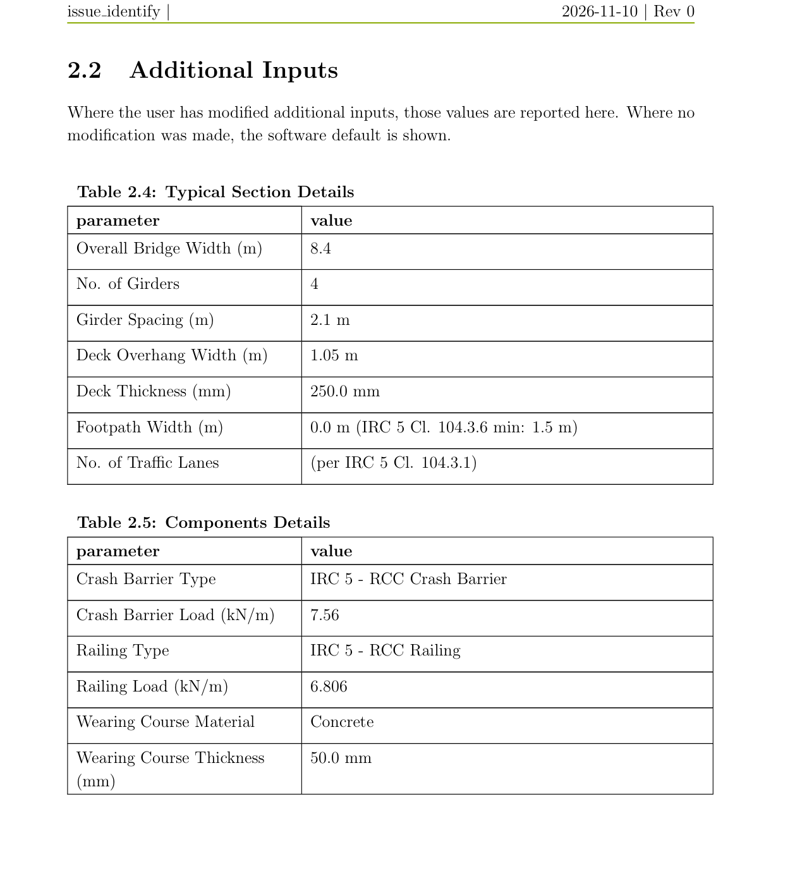
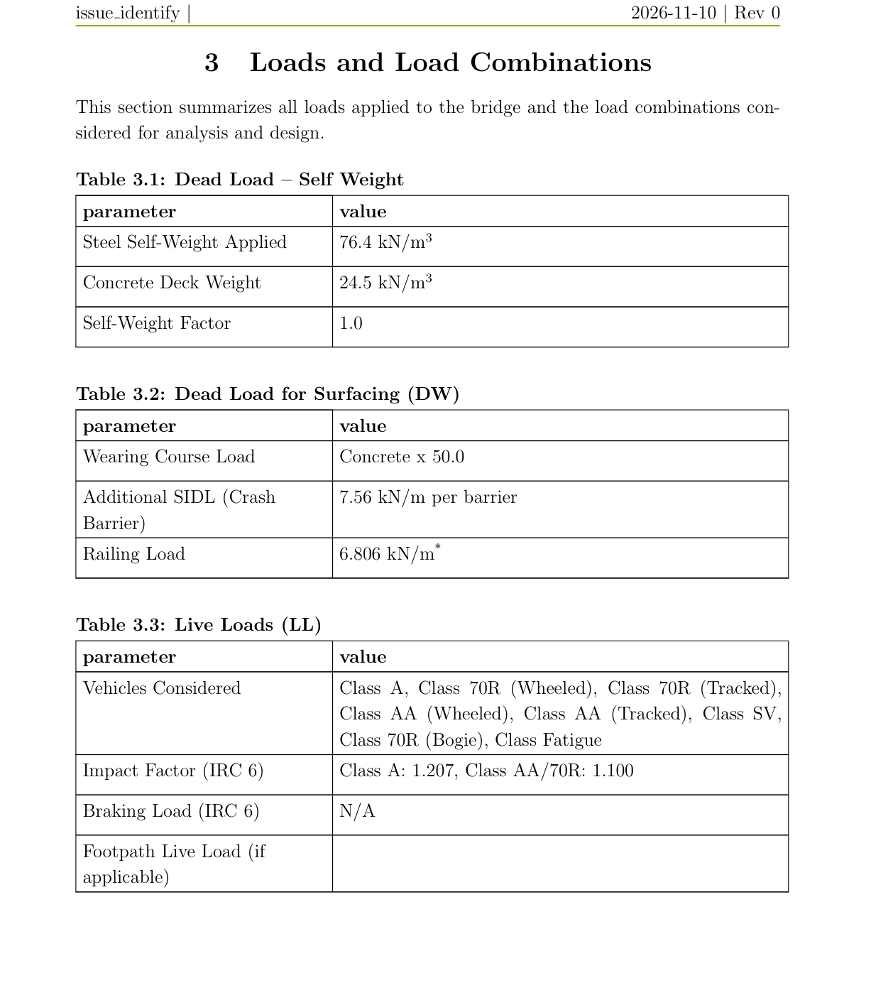

TITLE: [Bug] Default RCC railing load is 1.4715 kN/m in the input dictionary but 6.806 kN/m in the design and report

## Description
For the default railing (`IRC 5 - RCC Railing`, load mode `As per IRC 6`) the application uses two different values for the same input. The saved input file contains `1.4715` kN/m, but after loading it and running Design, the report shows **6.806 kN/m** in both Table 2.5 and Table 3.2. So the dead load used in the analysis is not the value that was saved, and the same design inputs can give two different railing loads depending on whether the Additional Inputs dialog has recomputed its values.

The same question (1.5 vs 6.806 kN/m) was raised in the upstream repository (Aditya-Donde/OsdagBridge #399) and has no answer there. This issue gives the cause. It follows the same pattern as #19 (loading an `.osi` file does not restore saved values), but for a different key and code path.

## Steps to reproduce
1. Load an input file saved with the default railing. The relevant lines are:
   ```
   typical_section.railing.type: IRC 5 - RCC Railing
   typical_section.railing.load_mode: As per IRC 6
   typical_section.railing.load_value: 1.4715
   ```
   (Span 30, Carriageway Width 7.5, Project Location Ahmedabad, everything else default.)
2. Click Design, then Generate Report.
3. Open Table 2.5 (Components Details) and Table 3.2 (Dead Load for Surfacing).

**Expected:** 1.4715 kN/m (the saved value), or one consistent value everywhere.
**Actual:** 6.806 kN/m.

## Environment
Windows 11, Python 3.12 (from `environment.yml`), branch `dev` @ d74f56d.

## Proof
Table 2.5 and Table 3.2 of the generated report:




When the same input is run through `PlateGirderBridge.set_input()` and `design()` from a script (no dialog involved), the dictionary keeps `1.4715`. So the change happens in the UI layer.

## Root cause
Two different calculations write to the same key `KEY_RL_LOAD_VALUE`:
1. `src/osdagbridge/core/bridge_types/plate_girder/defaults.py`, line 252: `railing_dead_load_kN_m()` = 150 kg/m (IRC 6:2017 Cl. 206.5, `irc6_2017.py::cl_206_5_railing_load`) = **1.4715 kN/m**.
2. `src/osdagbridge/desktop/ui/dialogs/additional_input/additional_inputs.py`, around line 1084 (railing values computation): `rcc_railing_load()["total_load_kN_per_m"]`, which is the barrier cross-section area times the RCC density = **6.806 kN/m**. It overwrites the value in the input dictionary.

## Suggested fix
Use one source for the default (decide which value is correct per IRC 6 Cl. 206.5 / IRC 5 Fig. 1) in both places, and make loading an `.osi` file keep the saved `load_value` instead of recomputing it:
```python
# defaults.py and additional_inputs.py (railing values computation) both call the same function:
load = railing_dead_load_kN_m()      # or rcc_railing_load(), but only one of them
```
