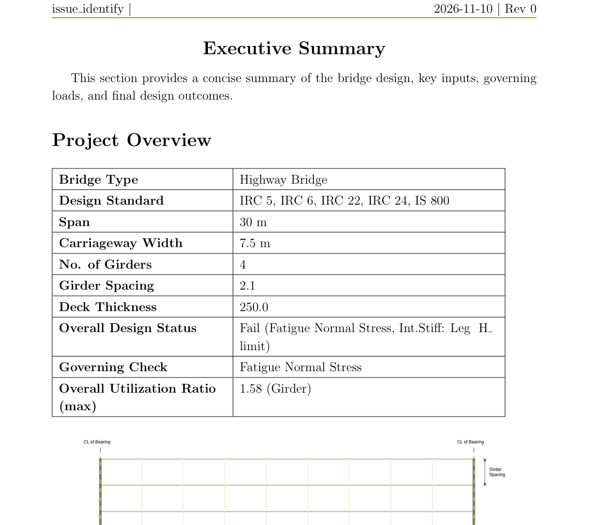
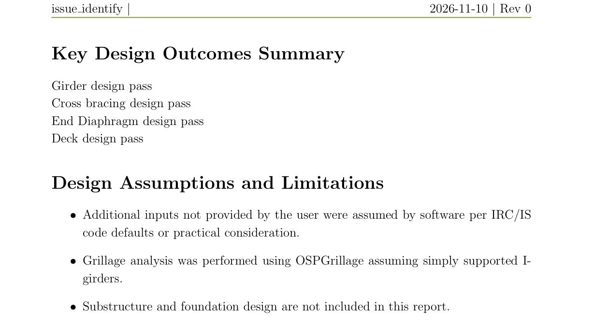

TITLE: [Bug] Executive Summary says "design pass" for every component even when Overall Design Status is Fail

## Description
In the report for the default case (Span 30 m, Carriageway Width 7.5 m, Optimized), the Executive Summary contradicts itself:
- **Project Overview:** `Overall Design Status: Fail (Fatigue Normal Stress, ...)` and `Overall Utilization Ratio (max): 1.58 (Girder)`
- **Key Design Outcomes Summary** (a few pages later): `Girder design pass`, `Cross bracing design pass`, `End Diaphragm design pass`, `Deck design pass`

A reader who only looks at the outcomes list is told the girder design passes, when the girder fails the fatigue check. It also happens at other spans (for example span 20 m gives a fatigue utilisation of 220.9 %).

This is about the text in the report only. #44 is a different problem: `design()` still completes and builds CAD when fatigue is above 100 %.

## Steps to reproduce
1. Span 30, Carriageway Width 7.5, everything else default, click Design.
2. Click Generate Report.
3. Compare the Project Overview table with the Key Design Outcomes Summary.

**Expected:** the girder line reads FAIL (and any failing component is marked).
**Actual:** all four lines say "pass".

## Environment
Windows 11, Python 3.12 (from `environment.yml`), branch `dev` @ d74f56d.

## Proof
Project Overview (Overall Design Status: Fail, UR 1.58):



Key Design Outcomes Summary on the following pages:



Output dictionary of this run: `util.fatigue = 157.26` (percent); the other girder utilisations are below 100.

## Root cause
`src/osdagbridge/core/reports/executive_summary.py`, lines 233-236, the four outcome lines are fixed text, not computed:
```
\noindent Girder design pass \\
Cross bracing design pass \\
End Diaphragm design pass \\
Deck design pass
```
Lines 77-110 of the same file already build the `failing` list for the girder checks, but it is only used for the "Overall Design Status" row. That row also only looks at girder checks, so a failing deck, cross-bracing or end-diaphragm check would not change it.

## Suggested fix
Derive the four lines from the data that is already loaded:
```python
girder_outcome = "FAIL" if failing else "pass"
cb_outcome     = "FAIL" if _any_ur_over_one(cb_results) else "pass"
ed_outcome     = "FAIL" if _any_ur_over_one(ed_results) else "pass"
deck_outcome   = "FAIL" if _any_ur_over_one(deck_results) else "pass"
# then use them in the template instead of the fixed word "pass"
```
and include the cross-bracing, end-diaphragm and deck results when computing "Overall Design Status".
