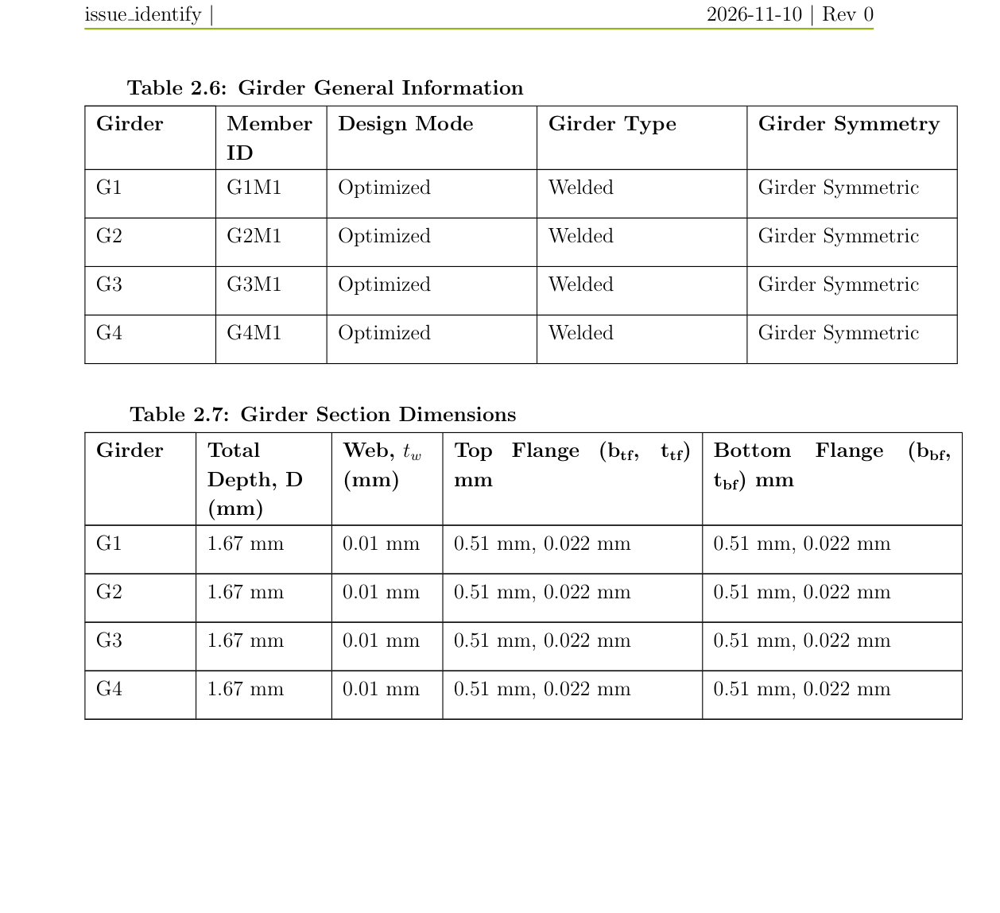

TITLE: [Bug] Report "Girder Section Dimensions" table prints metres labelled as mm (1.67 mm instead of 1670 mm)

## Description
After a successful design, Table 2.7 "Girder Section Dimensions" in the generated report shows the section sizes in metres, but the headers and the unit text say mm:

`G1 | 1.67 mm | 0.01 mm | 0.51 mm, 0.022 mm | 0.51 mm, 0.022 mm`

The real values are total depth 1670 mm, web 10 mm and flanges 510 x 22 mm. It happens for every design I ran (spans 20 to 45 m). The input dictionary also no longer matches the UI after Design: the UI shows mm, the dictionary holds metres.

## Steps to reproduce
1. Span 30, Carriageway Width 7.5, Project Location Ahmedabad, everything else default (Design Type Optimized).
2. Click Design, then Generate Report.
3. Open Chapter 2, Table 2.7 (Girder Section Dimensions).

**Expected:** 1670 mm, 10 mm, 510 mm, 22 mm.
**Actual:** 1.67 mm, 0.01 mm, 0.51 mm, 0.022 mm.

## Environment
Windows 11, Python 3.12 (from `environment.yml`), branch `dev` @ d74f56d.

## Proof


Running the same input through `set_input()` and `design()` from a script and comparing `input_dict` before and after, `design()` changed 35 keys, for example:
- `member_properties.girder_details.section_input.bottom_flange_width`: `510` -> `0.51`
- `member_properties.girder_details.section_input.bottom_flange_width.G1.M1`: `510` -> `0.51`
- `member_properties.girder_details.section_input.bottom_flange_thickness`: `'All'` -> `0.022`

## Root cause
`PlateGirderBridge._convert_girder_dims_mm_to_m()` (`src/osdagbridge/core/bridge_types/plate_girder/plategirderbridge.py`, line 536) converts the girder dimension keys from mm to metres **in place on `self.input_dict`**, and `_resolve_optimized_bounds_to_mm()` replaces `'All'` with the resolved thickness in metres. The report reads the same dictionary afterwards: `_dim_row()` in `src/osdagbridge/core/reports/chap2.py` (lines 241-256) prints the values with an `' mm'` suffix.

## Suggested fix
Convert for the calculation on a copy and keep `input_dict` in the UI units, or convert for display in the report. The smallest change is in `chap2.py`:
```python
def _mm(key):
    v = input_dict.get(key)
    try:
        return f"{float(v) * 1000:g} mm"      # stored in metres after design()
    except (TypeError, ValueError):
        return ""
# in _dim_row(), replace each _render_value(input_dict, <key>, ' mm') with _mm(<key>)
```
