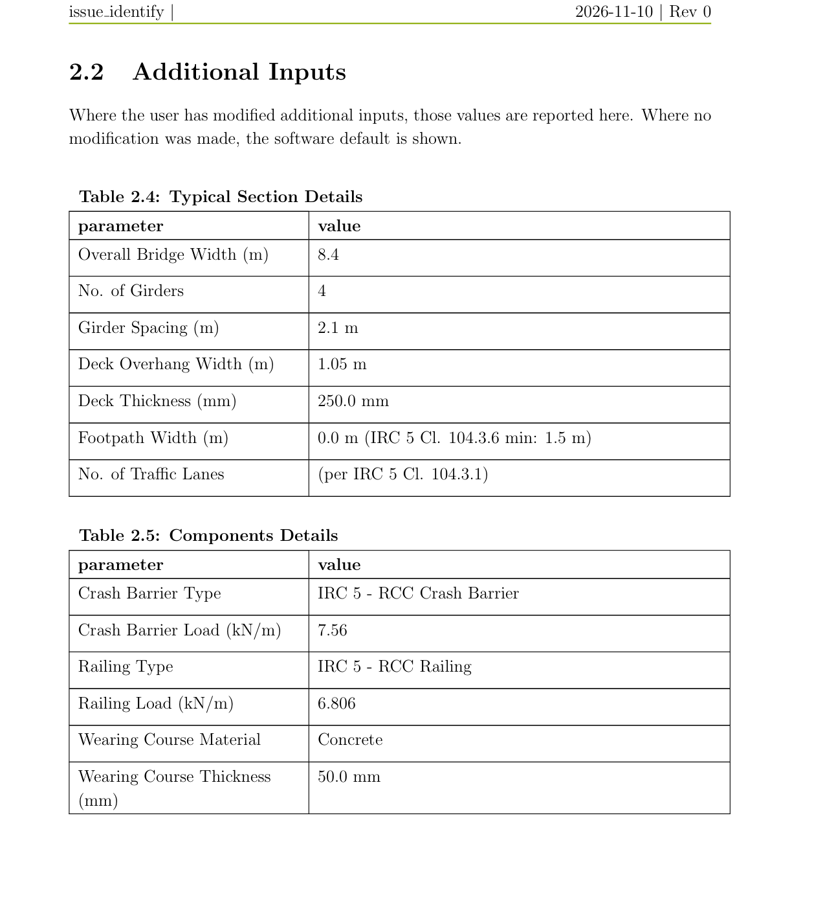
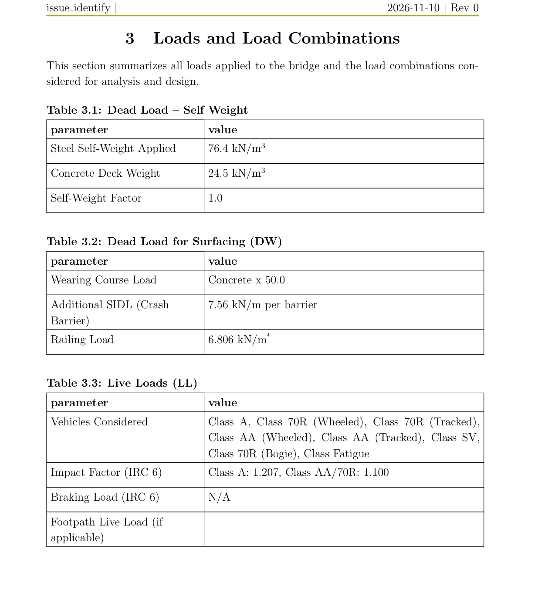
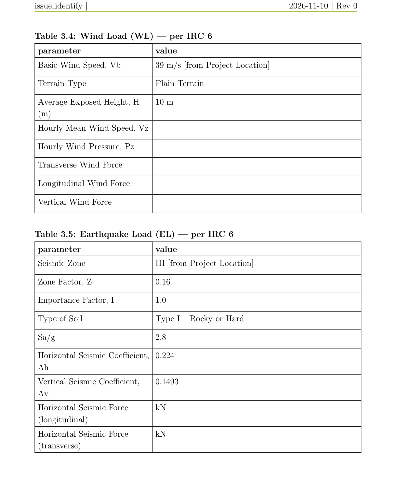

TITLE: [Bug] Report shows blank or N/A for No. of Traffic Lanes, Braking Load, wind and seismic load values

## Description
In the report for the default case (Span 30 m, Carriageway Width 7.5 m), several rows in Chapters 2 and 3 are empty or N/A even though the design completed:

| Table | Row | Shown |
|---|---|---|
| 2.4 Typical Section Details | No. of Traffic Lanes | no value, only "(per IRC 5 Cl. 104.3.1)" |
| 3.3 Live Loads | Braking Load (IRC 6) | `N/A` |
| 3.4 Wind Load | Hourly Mean Wind Speed Vz, Hourly Wind Pressure Pz, Transverse / Longitudinal / Vertical Wind Force | all five blank (Basic Wind Speed 39 m/s is shown) |
| 3.5 Earthquake Load | Horizontal Seismic Force (longitudinal / transverse) | only the unit `kN`, no number |

(Related: #48 reports placeholder sections in the generated report in general. This issue lists the specific rows, with the cause and a fix for each.)

## Steps to reproduce
1. Span 30, Carriageway Width 7.5, Project Location Ahmedabad, everything else default.
2. Click Design, then Generate Report.
3. Open Table 2.4, then Tables 3.3, 3.4 and 3.5.

## Environment
Windows 11, Python 3.12 (from `environment.yml`), branch `dev` @ d74f56d.

## Proof
Table 2.4 (No. of Traffic Lanes has no value):



Table 3.3 (Braking Load N/A):



Tables 3.4 and 3.5 (wind rows blank, seismic forces show only kN):



The saved `.osi` file does not contain `typical_section.lane_details.lane_table_count`.

## Root cause (all in `src/osdagbridge/core/reports/chap3.py` unless noted)
- **Vz / Pz:** `vz_str` and `pz_str` are computed from IRC 6 Table 12 as a fallback, but the table prints `input_dict[KEY_WL_HOURLY_MEAN_WIND]` and `input_dict[KEY_WL_HOURLY_WIND_PRESSURE]`, which are never filled.
- **Transverse / longitudinal / vertical wind force:** the table reads three `KEY_WL_*_FORCE` keys that nothing in the pipeline fills in, so the cells are always empty.
- **Seismic forces:** both rows are the literal `'' + r" kN"`.
- **Braking load and No. of Traffic Lanes:** both depend on `KEY_WC_LD_LANE_TABLE_COUNT`. The key appears to be written only when the lane table in Additional Inputs is used (`ui_fields_additional_input.py`, `count_id`), so a default design prints `N/A` and an empty lane count.

## Suggested fix
```python
# Vz / Pz: use the values already computed above
... & vz_str ...      ... & pz_str ...

# Lanes: when the key is missing, derive the lane count from the carriageway width with the
# same rule the Typical Section lane table uses, instead of printing N/A
lanes = input_dict.get(KEY_WC_LD_LANE_TABLE_COUNT) or derive_lane_count(carriageway_width)
```
For the seismic and wind forces, print the analysis result if available, or `N/A (not applicable)` instead of an empty value.
