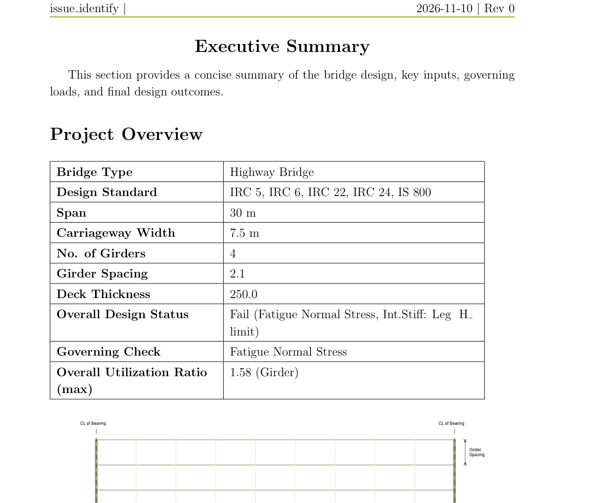

TITLE: [Bug] Executive Summary: Girder Spacing and Deck Thickness have no units, and the "<=" symbol is dropped from the status text

## Description
Two small formatting problems on the Executive Summary page (default case, Span 30 m, Carriageway Width 7.5 m):

1. **Missing units.** Girder Spacing shows `2.1` and Deck Thickness shows `250.0`, while Span (`30 m`) and Carriageway Width (`7.5 m`) have units. Table 2.4 of the same report shows the same values as `2.1 m` and `250.0 mm`.
2. **Dropped symbol.** Overall Design Status shows `Fail (Fatigue Normal Stress, Int.Stiff: Leg  H_ limit)`. The check name is "Leg <= H_limit"; the `<=` symbol is missing from the PDF, so the text reads wrongly. pdflatex also logs `LaTeX Error: Unicode character <= (U+2264) not set up for use with LaTeX`.

## Steps to reproduce
1. Span 30, Carriageway Width 7.5, everything else default, Design.
2. Generate Report and open the Executive Summary, Project Overview table.

## Environment
Windows 11, Python 3.12 (from `environment.yml`), branch `dev` @ d74f56d.

## Proof


## Root cause
1. `src/osdagbridge/core/reports/executive_summary.py`, lines 205 and 207: `_render_value(input_dict, KEY_TS_GIRDER_SPACING)` and `_render_value(input_dict, KEY_TS_DECK_THICKNESS)` are called without the unit argument, unlike Span and Carriageway Width on lines 199 and 201, which pass `' m'`.
2. `_tex()` in `src/osdagbridge/core/reports/report_utils.py` only replaces three special characters (the angle sign, a Unicode "x" and the multiplication sign) and passes the less-than-or-equal character through to pdflatex unchanged.

## Suggested fix
```python
# executive_summary.py, lines 205 and 207: pass the unit like Span does
\textbf{Girder Spacing} & """ + (_render_value(input_dict, KEY_TS_GIRDER_SPACING, ' m')) + r""" \\
\textbf{Deck Thickness} & """ + (_render_value(input_dict, KEY_TS_DECK_THICKNESS, ' mm')) + r""" \\

# report_utils.py: after the LaTeX escaping, map Unicode math symbols
_UNICODE_MATH = {"≤": r"$\leq$", "≥": r"$\geq$", "±": r"$\pm$"}
for uni, tex in _UNICODE_MATH.items():
    s = s.replace(uni, tex)
```
