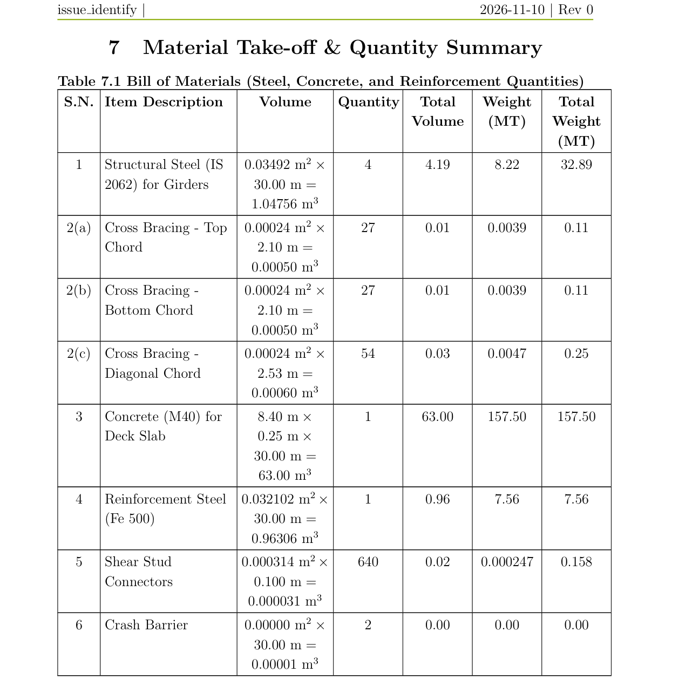

TITLE: [Bug] Crash barrier area is mm² in the defaults but m² in the Additional Inputs dialog, so the Material Take-off shows 0.00 MT for the crash barrier

## Description
The Material Take-off (Chapter 7, Table 7.1, row 6 "Crash Barrier") reads the crash barrier area `typical_section.crash_barrier.area` and divides it by 1,000,000, assuming it is in mm². The value is not always in mm²:
- the default value written by `defaults.py` is in **mm²** (`302282.768` for the default RCC crash barrier, which is also what the saved `.osi` file contains), but
- the Additional Inputs dialog writes the same key in **m²** (`0.3023`, the field is labelled "Area (m²)").

When the dialog path is used (as in the GUI), the quantity code divides an area that is already in m² by 1e6, and the crash barrier comes out as zero. For the default case the report shows **0.00 MT, where the correct total is 45.34 MT** (2 barriers x 22.67 MT). The table also has no warning, it just prints `0.00000 m2 x 30.00 m = 0.00001 m3`.

Related to #48 (placeholder values in the Material Take-off) but not a duplicate: here the row is filled in, with a wrong value, because of a unit mismatch. Same kind of dialog overwrite as in #64.

## Steps to reproduce
1. Span 30, Carriageway Width 7.5, Project Location Ahmedabad, everything else default (crash barrier `IRC 5 - RCC Crash Barrier`).
2. Click Design, then Generate Report.
3. Open Chapter 7, Table 7.1, row 6 (Crash Barrier).

**Expected:** `0.30228 m2 x 30.00 m = 9.06848 m3`, quantity 2, total weight 45.34 MT.
**Actual (GUI):** `0.00000 m2 x 30.00 m = 0.00001 m3`, total weight 0.00 MT.

Running the same default input through `set_input()` and `design()` from a script, without the dialog, gives the expected 0.30228 m2 and 45.34 MT, so the result depends on which code path set the area.

## Environment
Windows 11, Python 3.12 (from `environment.yml`), branch `dev` @ d74f56d.

## Proof
Table 7.1 from the report generated in the GUI:



The saved input file has `typical_section.crash_barrier.area: 302282.768` (mm²).

## Root cause
1. `src/osdagbridge/core/bridge_types/plate_girder/defaults.py`, line 204: `_update(KEY_CB_AREA, _cb_area["barrier_area"])  # mm²`.
2. `src/osdagbridge/desktop/ui/dialogs/additional_input/additional_inputs.py`, lines 933 and 947 (and the other crash barrier types in the same function): `KEY_CB_AREA: f"{area / 1e6:.4f}"`, which is m², matching the field label "Area (m²)" in `ui_fields_additional_input.py` line 98.
3. `src/osdagbridge/core/boq/boq_generator.py`, section "6. Crash Barrier": `cb_area = float(cb_area_val) / 1e6`, which only works for mm².

## Suggested fix
Use one unit for this key everywhere. Because the UI field is labelled m², the simplest consistent choice is to store m²:
```python
# defaults.py line 204
_update(KEY_CB_AREA, _cb_area["barrier_area"] / 1e6)    # m2, same as the dialog

# boq_generator.py
cb_area = float(cb_area_val)                             # already m2
```
(or keep mm² in the dictionary and remove the `/ 1e6` in the dialog). A guard in the BOQ, for example treating values above 100 as mm², would also avoid a silent zero.
